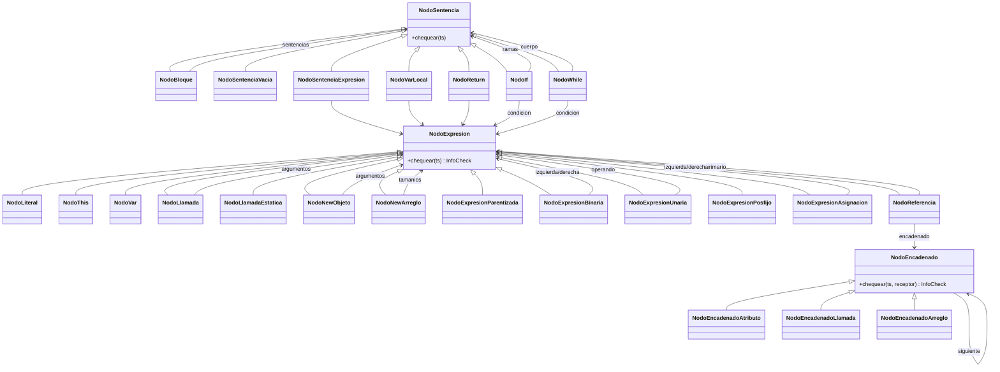

# Etapa 4 – Base: AST y Chequeo de Sentencias de MiniJava

Este documento registra, fase por fase, la implementación de los requisitos
**básicos** de la Etapa 4 del compilador de MiniJava: construcción de los AST de
métodos y constructores y chequeo de sentencias (resolución de nombres, chequeo
de tipos e información estructural). **No** se implementan los logros de la
etapa; el alcance es exactamente el de la semántica base.

Todo el código vive en `compilador-minijava/`. Las instrucciones de compilación y
ejecución están al final.

---

## Resumen del alcance

Antes de esta etapa el compilador llegaba hasta:

1. análisis léxico,
2. análisis sintáctico con construcción de la Tabla de Símbolos (TS),
3. chequeo de declaraciones (`estaBienDeclarada`) y consolidación (`consolidar`).

La Etapa 4 agrega:

1. **AST por unidad**: durante el parseo se construye el árbol del bloque de cada
   método y constructor y se asocia a su entrada de la TS.
2. **Chequeo de sentencias** sobre esos AST, después del chequeo y la
   consolidación de declaraciones:
   - resolución de nombres (locales, parámetros, atributos, métodos),
   - chequeo de tipos (operadores, asignaciones, llamadas, retornos, arreglos),
   - información estructural (destino asignable y forma de sentencia de llamada),
   - ámbitos léxicos de variables locales,
   - contexto estático,
   - conformidad de tipos de MiniJava (genéricos y arreglos invariantes).

---

## Fase 1 – Modelo de dominio para el chequeo de sentencias

Se extendió el paquete `analizadorsemantico` con las piezas que el chequeo de
cuerpos necesita y que la Etapa 3 no tenía.

### 1.1 Unidades y cuerpos

- `Unidad` (nueva, abstracta, extiende `Entidad`): superclase común de `Metodo`
  y `Constructor`. Agrupa parámetros ordenados, aridad, condición de estático y
  el **AST del cuerpo** (`NodoBloque`).
  - `chequearCuerpo(ts)` dispara el chequeo del bloque si existe.
- `Metodo` y `Constructor` ahora extienden `Unidad` (antes extendían `Entidad`).
  El constructor por defecto queda con cuerpo `null` (vacío).

### 1.2 Ámbitos y variables locales

- `VariableLocal` (nueva): nombre, tipo, token de declaración y bloque de
  pertenencia.
- `Bloque` (nuevo): ámbito léxico con referencia al bloque contenedor y mapa de
  variables locales. Permite implementar la visibilidad de locales.

`TablaDeSimbolos` ahora mantiene:

- `unidadActual` (método o constructor en chequeo),
- `bloqueActual`,
- `entrarBloque()` / `salirBloque()`,
- `buscarVariableLocal(nombre)`, que sube por la cadena de ámbitos.

### 1.3 Tipos y conformidad

- `TipoNull` (nuevo): tipo especial del literal `null`. No puede declararse;
  conforma con referencias, parámetros de tipo y arreglos, pero no con
  primitivas.
- `SemanticaUtil` (nuevo) centraliza:
  - `conforma(origen, destino, ts)` con las reglas de MiniJava:
    - primitivas sólo consigo mismas, sin promociones;
    - `null` según la regla anterior;
    - `void` no conforma con nada;
    - parámetros de tipo sólo consigo mismos (sin cota implícita `Object`);
    - arreglos invariantes y, además, todo arreglo conforma con `Object`;
    - referencias: se recorre la cadena de herencia aplicando sustituciones
      genéricas; toda referencia conforma con `Object`;
    - `Caja<String>` no conforma con `Caja<Object>` (invariancia).
  - `sustitucionVista(entidad, receptor)`: vista de los miembros de una entidad
    bajo el argumento genérico del receptor.
  - `buscarMetodo` / `buscarAtributo` sobre la vista consolidada.
  - `esContextoEstatico`, `tipoDeClaseActual`, `contieneParametro`,
    `validarTipo` y `parametroDeContexto`.
- `InfoCheck` (nuevo): resultado de chequear una expresión. Conserva:
  - `tipo`,
  - `asignable` (¿es un destino de asignación?),
  - `llamada` (¿es admisible como sentencia de llamada?).
  Separar estas propiedades es esencial: `a.length` y `a[0]` pueden ser `int`,
  pero sólo el segundo es asignable; una variable es asignable pero no es una
  llamada; una creación de objeto es llamada pero no asignable.

### 1.4 Otros ajustes

- `Clase` registra `unidadesPropias` (métodos y constructores **declarados** en
  ella, incluido el constructor por defecto). La consolidación agrega miembros
  heredados a los mapas, pero no a esta lista, de modo que cada cuerpo se
  chequea una única vez y en su clase de origen.
- `Metodo.estaBienDeclarada` rechaza el uso del parámetro de tipo de la clase en
  encabezados de métodos estáticos.
- `TipoReferencia` incorpora una marca de notación diamante (`<>`) para
  preservar el comportamiento previo de la Etapa 3 sin exigir inferencia (los
  logros de genericidad avanzada no forman parte de esta entrega).

---

## Fase 2 – Diseño e implementación de los AST

Se creó el paquete `analizadorsemantico.ast`. Cada tipo de nodo es una clase; la
herencia modela las relaciones “es-un”. Los nodos conservan tokens para poder
reportar el error con el lexema y la línea correctos.

### 2.0 Gramática de diseño y gramática de construcción

Los tipos de nodo del AST se **diseñan** a partir de la gramática original de la
clase (los constructores sintácticos que tienen significado), pero el AST se
**construye** durante el análisis sintáctico con una EDT sobre la gramática
LL(1) que efectivamente implementa el parser. La cátedra pide explícitamente
esta separación:

- El diseño se guía por la gramática original: “una buena heurística para
  diseñar el AST es mirar la gramática original del lenguaje y diseñar los
  distintos tipos de nodo base a sus reglas”
  (`../md/Clase 09 - SemI2 - AST diseno y ctruccion/Clase 09 - SemI2 - AST diseno y ctruccion.md:288`),
  porque “nos da una guía de cómo diseñar el AST”
  (`../md/Clase 09 - SemI2 - AST diseno y ctruccion/Clase 09 - SemI2 - AST diseno y ctruccion.md:252`).
- La construcción se hace sobre la gramática del parser: “Haremos una EDT sobre
  la gramática utilizada en el Analizador Sintáctico”
  (`../md/Clase 09 - SemI2 - AST diseno y ctruccion/Clase 09 - SemI2 - AST diseno y ctruccion.md:297`), y “esta EDT debe
  realizarse sobre la versión de la gramática de MiniJava que usaron para
  implementar el analizador sintáctico”
  (`../md/Pautas Etapa 4/Pautas Etapa 4.md:50`).

Las diferencias entre ambas gramáticas se resuelven en el parser, no en el
diseño:

- **Recursión a izquierda**: `<ExpresionCompuesta>` y `<Referencia>` son
  recursivas a izquierda en la gramática original. La versión LL(1)
  (`<ECResto>`, `<RResto>`) las reconoce con recursión a derecha y las arma con
  un acumulador, produciendo árboles asociativos a izquierda, como muestra
  “Traduciendo Recursión a Izquierda”
  (`../md/Clase 11 - SemI2 - Chequeo de Sentencias - Informacion Estructural/Clase 11 - SemI2 - Chequeo de Sentencias - Informacion Estructural.md:127,135`).
  Por eso `eCResto`/`rResto` devuelven el nodo acumulado.
- **Sentencias de expresión**: la gramática original distingue
  `<Sentencia> ::= <Asignacion> ;` y `<Sentencia> ::= <Llamada> ;`, pero ambas
  son alias de `<Expresion>`
  (`../Etapa 2/Etapa 2 Gramática original:32-33,39-40`). La transformación LL(1)
  las unifica en `<Sentencia> ::= <Expresion> ;`, tal como documenta el informe
  de la Etapa 2 (`../Etapa 2/codigo/Informe_etapa2.tex:187-189`). Por eso hay un
  único `NodoSentenciaExpresion`, que clasifica la forma durante el chequeo
  (`NodoExpresionAsignacion` vs. `InfoCheck.esLlamada()`).

Correspondencia entre producciones de la gramática original y nodos del AST:

| Producción (gramática original) | Nodo |
|---|---|
| `<AccesoVar> ::= idMetVar` | `NodoVar` |
| `<LlamadaMetodo> ::= idMetVar <ArgsActuales>` | `NodoLlamada` |
| `<LlamadaMetodoEstatico>` | `NodoLlamadaEstatica` |
| `<LlamadaConstructor> ::= new <TipoReferencia> <ArgsActuales>` | `NodoNewObjeto` |
| `<CrearArreglo> ::= new <TipoBase> <DimensionesConTamanio>` | `NodoNewArreglo` |
| `<ExpresionParentizada>` | `NodoExpresionParentizada` |
| `<Primario>` `this` / `stringLiteral` | `NodoThis` / `NodoLiteral` |
| `<Primitivo>` | `NodoLiteral` |
| `<Expresion>` con `<OperadorAsignacion>` | `NodoExpresionAsignacion` |
| `<ExpresionCompuesta>` con `<OperadorBinario>` | `NodoExpresionBinaria` |
| `<ExpresionBasica>` con `<OperadorUnario>` | `NodoExpresionUnaria` |
| `<PosfijoOpcional>` (sólo en la LL(1)) | `NodoExpresionPosfijo` |
| `<VarEncadenada> ::= . idMetVar` | `NodoEncadenadoAtributo` |
| `<MetodoEncadenado> ::= . idMetVar <ArgsActuales>` | `NodoEncadenadoLlamada` |
| `<AccesoArreglo> ::= [ <Expresion> ]` | `NodoEncadenadoArreglo` |
| `<Bloque>` / `<Sentencia> ;` | `NodoBloque` / `NodoSentenciaVacia` |
| `<VarLocal>` / `<Return>` / `<If>` / `<While>` | `NodoVarLocal` / `NodoReturn` / `NodoIf` / `NodoWhile` |
| `<Sentencia> ::= <Asignacion> ;` / `<Llamada> ;` | `NodoSentenciaExpresion` |

En síntesis: los **tipos de nodo** reflejan los constructores significativos de
la gramática original; la **forma del árbol** es la que produce el parseo LL(1)
implementado. Las diferencias de sintaxis que el parser acepta de más se
detallan en el Anexo A.

### 2.1 Jerarquía de expresiones

```
NodoExpresion (abstracta)
├── NodoLiteral
├── NodoThis
├── NodoVar
├── NodoLlamada
├── NodoLlamadaEstatica
├── NodoNewObjeto
├── NodoNewArreglo
├── NodoExpresionParentizada
├── NodoExpresionBinaria
├── NodoExpresionUnaria
├── NodoExpresionPosfijo
├── NodoExpresionAsignacion
└── NodoReferencia ──────────────┐
                                  │ usa
NodoEncadenado (abstracta) ◄──────┘
├── NodoEncadenadoAtributo
├── NodoEncadenadoLlamada
└── NodoEncadenadoArreglo
```

`NodoReferencia` modela `<Primario> <RResto>`: un primario seguido de un
encadenado opcional. Cada eslabón recibe el tipo estático del receptor, lo
controla y delega en el siguiente. Esto cubre accesos como
`crearPersona().edad`, `matriz[0].length` o `caja.obtener().toString()`.

### 2.2 Jerarquía de sentencias

```
NodoSentencia (abstracta)
├── NodoBloque
├── NodoSentenciaVacia
├── NodoSentenciaExpresion
├── NodoVarLocal
├── NodoReturn
├── NodoIf
└── NodoWhile
```

### 2.3 Métodos de chequeo

- Toda expresión implementa `InfoCheck chequear(TablaDeSimbolos ts)`.
- Toda sentencia implementa `void chequear(TablaDeSimbolos ts)`.
- Toda expresión aplica el patrón de **responsabilidad + delegación**: controla
  lo propio y delega en sus hijos.

### 2.4 Diagrama de clases (Mermaid)



---

## Fase 3 – Construcción de los AST durante el análisis sintáctico

Se modificó `AnalizadorSintactico` para que las acciones semánticas construyan
nodos, siguiendo una EDT sobre la **gramática LL(1)** que el parser ya
implementaba (ver §2.0). Los tipos de nodo, en cambio, provienen del diseño
guiado por la gramática original; la traducción de las reglas recursivas a
izquierda se hace con acumuladores en el parser.

### 3.1 Sentencias

Cada método del parser devuelve el nodo correspondiente:

| Producción | Nodo construido |
|---|---|
| `<Bloque>` | `NodoBloque` |
| `<Sentencia> ;` | `NodoSentenciaVacia` |
| `<Expresion> ;` | `NodoSentenciaExpresion` |
| `var id = ExpresionCompuesta` | `NodoVarLocal` |
| `return ExpresionOpcional` | `NodoReturn` |
| `if (Expresion) Sentencia else Sentencia` | `NodoIf` |
| `while (Expresion) Sentencia` | `NodoWhile` |

### 3.2 Expresiones

- `expresion()` construye `NodoExpresionAsignacion` si aparece `=`.
- `expresionCompuesta()` / `eCResto()` construyen `NodoExpresionBinaria`
  asociando a izquierda, respetando el único nivel de binarios de la gramática.
- `expresionBasica()` construye `NodoExpresionUnaria` y
  `NodoExpresionPosfijo`.
- `referencia()` construye `NodoReferencia` cuando hay encadenado y devuelve el
  primario directo cuando no lo hay.
- `rResto()` encadena `NodoEncadenadoAtributo`, `NodoEncadenadoLlamada` y
  `NodoEncadenadoArreglo`.
- `primario()` construye `NodoThis`, `NodoLiteral` (string), `NodoVar`,
  `NodoLlamada`, `NodoNewObjeto`, `NodoNewArreglo`, `NodoLlamadaEstatica` o
  `NodoExpresionParentizada`.

### 3.3 Asociación a la TS

Al terminar de parsear el bloque de un método o constructor, el nodo se asocia a
la unidad antes de insertarla en la clase:

```java
NodoBloque cuerpo = bloque();
Metodo metodo = new Metodo(tokenNombre, tipoRetorno, parametros, esEstatico, ts);
metodo.setCuerpo(cuerpo);
agregarMetodo(metodo);
```

Además se refactorizó `tipoReferenciaNueva` para devolver el `TipoReferencia`
usado por `new`, conservando el control de la notación diamante que ya existía.

---

## Fase 4 – Chequeo de sentencias

El chequeo se ejecuta **después** de `estaBienDeclarada()` y `consolidar()`.
`TablaDeSimbolos.chequearCuerpos()` recorre las clases y, para cada una, sólo
las unidades propias; así un cuerpo heredado no se rechequea en el descendiente.

### 4.1 Resolución de nombres

Para un identificador sin receptor (`NodoVar`) se busca en este orden:

1. variable local visible (bloque actual hacia contenedores),
2. parámetro de la unidad actual,
3. atributo de la clase actual (incluidos los heredados consolidados).

Si se selecciona un atributo en contexto estático se reporta error. Si no se
encuentra, “la variable X no fue declarada”.

Para llamadas implícitas (`NodoLlamada`) se busca la clave `(nombre, aridad)` en
los métodos de la clase actual, incluidos los heredados. En contexto estático
sólo se admiten métodos estáticos.

Para receptores explícitos se usa el **tipo estático** del receptor:

- referencias: se busca el miembro en la clase/interfaz y se aplica la
  sustitución genérica correspondiente a la vista;
- arreglos: sólo `length` (sólo lectura) y `toString()` sin argumentos;
- primitivas, `null`, `void` o parámetros de tipo no instanciados no permiten
  seleccionar miembros.

### 4.2 Chequeo de tipos

- Operadores: `int` para `+ - * / %` y comparaciones; `boolean` para `&& || !`;
  `== !=` exigen conformidad en alguna dirección; sin promociones ni
  concatenación con `+`.
- Asignación: el lado izquierdo debe ser asignable y el derecho debe conformar
  con el izquierdo. El resultado tiene el tipo del destino y no es asignable.
- Llamadas y creaciones: se controla aridad y que cada argumento conforme con el
  formal correspondiente; los errores de argumentos se reportan sobre el token
  de la llamada.
- Creación de arreglos: cada dimensión debe ser `int`; el tipo base debe ser
  válido y, si es genérico, no puede omitirse el argumento.
- `var`: el inicializador se chequea antes de declarar la variable; no se admite
  `void` ni `null` como origen de inferencia.
- `if` / `while`: la condición debe ser `boolean`.
- `return`: en `void` sólo `return;`; en métodos con retorno, `return e;` con
  conformidad; en constructores sólo `return;`.

### 4.3 Información estructural

`InfoCheck` porta `asignable` y `llamada`. Reglas implementadas:

- locales, parámetros, atributos, componentes de arreglo: asignables;
- `length`: no asignable;
- literales, `this`, paréntesis, resultados de operadores, asignaciones,
  creaciones: no asignables;
- una llamada a método o la creación de un objeto son admisibles como sentencia
  de llamada; una creación de arreglo no lo es;
- una expresión parentizada conserva el tipo pero **pierde** ambas propiedades
  (`(x) = 3`, `(x = 3);`, `(metodo());`, `(objeto).metodo();` se rechazan);
- una sentencia de expresión sólo es válida si es una asignación o termina en
  una llamada (por eso `crearPersona().edad;` se rechaza aunque su tipo sea
  asignable).

### 4.4 Ámbitos y declaraciones locales

- Al entrar a un bloque se crea un ámbito; al salir se restaura el anterior.
- Una local no puede repetir el nombre de un parámetro de la unidad ni el de una
  local visible en el bloque actual o en un contenedor.
- Puede ocultar un atributo.
- Bloques hermanos pueden reutilizar nombres.
- El inicializador no ve a la variable que se está declarando.
- Se rechaza una declaración local como cuerpo directo de `if`, `else` o
  `while`.
- Se chequean todas las sentencias, incluso después de un `return` (no se
  rechaza código inalcanzable).

### 4.5 Contexto estático

- No se permite `this` ni el acceso implícito a atributos o métodos de
  instancia.
- Sí se permite acceder a miembros de instancia mediante un receptor explícito
  obtenido de un parámetro, local, llamada o creación.
- Se rechaza el parámetro de tipo de la clase en encabezados y cuerpos de
  métodos estáticos (incluido dentro de arreglos o argumentos genéricos).

### 4.6 Conformidad de MiniJava

Se respetaron explícitamente las diferencias con Java:

- genéricos y arreglos invariantes;
- sin tipos raw (fuera de la excepción de herencia sin argumento);
- sin cotas para parámetros de tipo;
- herencia genérica sin argumento conserva el parámetro original;
- arreglos conforman con `Object`, pero no entre arreglos de distinto tipo base;
- `null` conforma con referencias, parámetros y arreglos, no con primitivas;
- `void` no conforma con tipos de valor.

---

## Fase 5 – Integración y reporte de errores

`ModuloPrincipal` ahora ejecuta, en orden:

```java
analizadorSintactico.analizar();
tablaDeSimbolos.estaBienDeclarada();
tablaDeSimbolos.consolidar();
tablaDeSimbolos.chequearCuerpos();
```

La salida mantiene el contrato existente:

- éxito: `Compilacion Exitosa` y `[SinErrores]`;
- error: mensaje en español y `[Error:<lexema>|<linea>]`, deteniéndose en el
  primer error.

Se actualizaron `Compilar.sh` y `Compilar.bat` para incluir el nuevo paquete
`src/main/java/analizadorsemantico/ast/*.java`.

---

## Fase 6 – Verificación

Se ejecutó la batería completa:

```
./CorrerTests.sh
```

Resultado: **OK (15 tests)**.

Casos incluidos:

- Los 5 `sinErrores` originales de la cátedra.
- Los 5 `conErrores` originales (`semIIError01..05`), que antes fallaban.
- Casos de regresión agregados:
  - `sinErrores/semIICorrecto06.java`: genéricos, arreglos, `this`, `length`,
    `toString`, `if`, `while`, `null`, métodos estáticos.
  - `sinErrores/semIICorrecto07.java`: interfaces, herencia y conformidad.
  - `conErrores/semIIError06.java`: acceso implícito a atributo en contexto
    estático.
  - `conErrores/semIIError07.java`: retorno con tipo incompatible.
  - `conErrores/semIIError08.java`: creación de entidad genérica sin argumento
    (tipo raw).

También se verificaron manualmente, entre otros:

- vistas genéricas en accesos y llamadas (`Caja<String>` ve `T` como `String`);
- herencia genérica con y sin argumento;
- invariancia de genéricos y arreglos;
- `null` en asignaciones y comparaciones;
- `this` y accesos implícitos válidos/inválidos en contexto estático;
- creación de arreglos con tipo base primitivo, referencia, genérico o `T`;
- paréntesis y pérdida de propiedades estructurales;
- declaraciones locales repetidas, ocultamiento de atributos y visibilidad por
  bloques.

---

## Compilación y ejecución

Desde `compilador-minijava/`:

```bash
./Compilar.sh
java -jar Compilador.jar <archivo_fuente>
```

Windows:

```bat
Compilar.bat
java -jar Compilador.jar <archivo_fuente>
```

Tests:

```bash
./CorrerTests.sh
```

---

## Archivos principales

Nuevos en `analizadorsemantico`:

- `Unidad.java`, `VariableLocal.java`, `Bloque.java`, `TipoNull.java`,
  `InfoCheck.java`, `SemanticaUtil.java`.

Nuevos en `analizadorsemantico.ast`:

- expresiones: `NodoExpresion`, `NodoLiteral`, `NodoThis`, `NodoVar`,
  `NodoLlamada`, `NodoLlamadaEstatica`, `NodoNewObjeto`, `NodoNewArreglo`,
  `NodoExpresionParentizada`, `NodoExpresionBinaria`, `NodoExpresionUnaria`,
  `NodoExpresionPosfijo`, `NodoExpresionAsignacion`, `NodoReferencia`;
- encadenados: `NodoEncadenado`, `NodoEncadenadoAtributo`,
  `NodoEncadenadoLlamada`, `NodoEncadenadoArreglo`;
- sentencias: `NodoSentencia`, `NodoBloque`, `NodoSentenciaVacia`,
  `NodoSentenciaExpresion`, `NodoVarLocal`, `NodoReturn`, `NodoIf`,
  `NodoWhile`.

Modificados:

- `AnalizadorSintactico.java` (construcción de AST),
- `Metodo.java`, `Constructor.java` (extienden `Unidad`),
- `Clase.java` (unidades propias),
- `TablaDeSimbolos.java` (ámbitos, unidad actual, `chequearCuerpos`),
- `TipoReferencia.java` (marca de diamante),
- `ModuloPrincipal.java` (dispara el chequeo de cuerpos),
- `Compilar.sh` / `Compilar.bat` (nuevo paquete en el `javac`).

---

## Anexo A – Diferencias de sintaxis respecto de la gramática original

El parser implementado (heredado de las Etapas 2 y 3) acepta algunos constructos
que no figuran en el archivo de la gramática original
(`../Etapa 2/Etapa 2 Gramática original`) ni en la semántica base. Se listan para
dejar explícita la diferencia; el chequeo de sentencias de la Etapa 4 base no los
trata de forma especial.

| Constructo | Gramática original | Gramática implementada (LL1) |
|---|---|---|
| Modificadores `public` / `private` | no figuran | `<VisibilidadOpcional> ::= public \| private \| ε` |
| Posfijos `++` / `--` | no figuran (`<ExpresionBasica> ::= <OperadorUnario> <Operando> \| <Operando>`) | `<PosfijoOpcional> ::= ++ \| -- \| ε` |
| Argumentos genéricos anidados (`Caja<Par<String>>`) | no (`<InstanciadoOParametrico> ::= idGen \| idClase`) | `instanciadoOParametrico` es recursivo |
| Notación diamante `new Caja<>()` | no | admitida si la clase es genérica (`tipoReferenciaNueva`) |

Estas extensiones provienen de los logros de las Etapas 2 y 3. Los controles
semánticos de esta entrega que las alcanzan son los mínimos: por ejemplo, el
posfijo se admite sólo dentro de expresiones y sobre operandos `int` asignables,
y `new Caja<>()` no infiere el argumento (eso corresponde al logro de
genericidad avanzada). Las restricciones sintácticas de la gramática base
(diamante, instanciaciones anidadas, etc.) que la semántica describe no se
fuerzan cuando el parser ya las admitía.

---

## Fuera de alcance (logros)

No se implementaron los logros de la etapa: MiniLambdas, `for`, retorno en todos
los caminos sin código muerto, floats y coerción, ternario, genericidad avanzada
(inferencia por diamante completa), `instanceof`, visibilidad, `super`, métodos
genéricos, multi-detección de errores, atributos inicializados, postfijos como
sentencia ni `main`. La sintaxis aceptada sigue siendo la de la Etapa 3; los
controles agregados son sólo los de la semántica base de sentencias.
